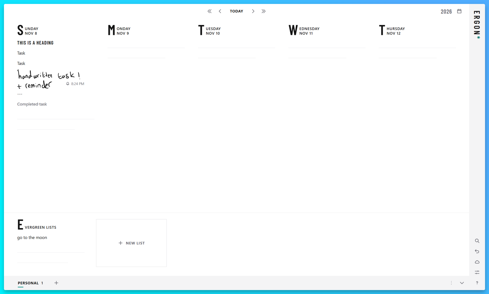
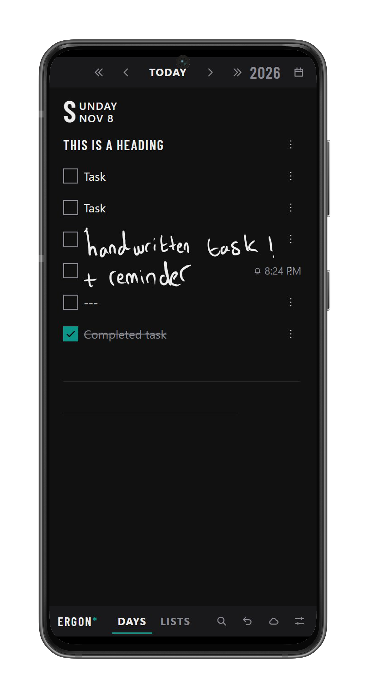

A lovely weekly planner/todo app. Local-first, end-to-end encrypted sync, with handwriting and reminders. runs in the browser, on the desktop and on Android.

<!-- Screenshots: week view with a few todos, a heading and a list tab (light theme), and the phone layout (dark theme) -->

<table>
  <tr>
    <td valign="bottom"></td>
    <td valign="bottom"></td>
  </tr>
</table>

## Features

- Day grid with 1 to 7 visible days, calendar view and easy date navigation
- Todos, headings, lists and tabs, drag and drop (or Alt + ↑/↓) to reorder
- Recurring todos and reminders
- Handwriting with a pen support
- Search, TeuxDeux import, JSON and Markdown export
- Works offline as a PWA
- Light and dark theme, configurable accent color
- Sync that the server cannot read: data is encrypted on your devices and unlocked by a recovery phrase. Link more devices with a QR code.

## Hosted version

A hosted version is planned for people who don't want to run a server. The app works without any server, and sync is optional.

## Self-hosting

The sync server is a single Go binary with SQLite. It also serves the web app. It only ever stores ciphertext.

### Docker

```sh
git clone <this repository>
cd ergon
docker compose up -d
```

Open `http://localhost:8080`. Data lives in the `data` volume (`/data/ergon.db`).

By default registration needs an invite code. On first start, when there are no accounts yet, the server logs one:

```sh
docker compose logs ergon | grep invite
```

Create more with:

```sh
docker compose exec ergon /ergon invite 3
```

Then use the cloud button in the app to create an account with the server's address and an invite code. Write down the recovery phrase. The server cannot decrypt your data, so without the phrase it cannot be recovered.

### HTTPS

Put the server behind a reverse proxy with TLS. Service workers, Web Push and offline storage need HTTPS (`localhost` is exempt). [deploy/Caddyfile.example](deploy/Caddyfile.example) is a ready-made Caddy config; it turns off response buffering, which the live-update stream (`/api/v1/events`) needs. Any other proxy needs the same.

### Configuration

Set these as environment variables, for example under `environment:` in [docker-compose.yml](docker-compose.yml).

| Variable              | Default                                 | Description                                                                        |
| --------------------- | --------------------------------------- | ---------------------------------------------------------------------------------- |
| `ERGON_ADDR`          | `:8080`                                 | Listen address                                                                     |
| `ERGON_DB`            | `ergon.db` (`/data/ergon.db` in Docker) | SQLite database path                                                               |
| `ERGON_REGISTRATION`  | `invite`                                | `open`: anyone can register. `invite`: needs an invite code. `closed`: nobody new. |
| `ERGON_ALLOWLIST`     |                                         | Comma-separated public keys that can always register, in every mode                |
| `ERGON_VAPID_SUBJECT` | `mailto:ergon@localhost`                | Contact URL sent to push services; set it to a real `mailto:` or `https:` address  |

### Without Docker

Requires Node 24+, pnpm and Go 1.26+.

```sh
pnpm install
pnpm build
cp -r apps/web/dist/. apps/server/internal/web/static/
cd apps/server
go build -o ergon .
ERGON_DB=./ergon.db ./ergon
```

The web build is embedded in the binary, so the result is one file to deploy. `./ergon invite [n]` prints invite codes.

### Backups

Copy the database while the server is stopped, or use `sqlite3 ergon.db ".backup backup.db"`.

## Desktop and Android

The Tauri app has the same UI, stores data in native SQLite and keeps sync credentials in the OS keychain (Android Keystore on Android). Installers for Windows, macOS and Linux are attached to the [releases](../../releases). Build from source with:

```sh
pnpm --filter @ergon/desktop build
pnpm --filter @ergon/desktop android:build
```

The desktop build needs Rust. The Android build also needs JDK 17, the Android SDK and NDK (`ANDROID_HOME`, `NDK_HOME`) and the Android Rust targets. iOS is not available yet.

## Development

Requires Node 24+, pnpm and, for the end-to-end tests and the server, Go.

```sh
pnpm install
pnpm dev        # web app; /api is proxied to ERGON_SERVER (default http://localhost:8080)
pnpm test       # unit tests (vitest)
pnpm e2e        # Playwright; builds the web app and starts the Go server
pnpm lint       # oxlint, prettier, tsc

cd apps/server && go test ./...
```

| Path            | Contents                                                                |
| --------------- | ----------------------------------------------------------------------- |
| `packages/core` | Data model, clock, merge, recurrence, reminders, database, sync, crypto |
| `apps/web`      | Solid + Vite app                                                        |
| `apps/desktop`  | Tauri shell for desktop and Android                                     |
| `apps/server`   | Go sync and push server                                                 |
| `protocol`      | Sync protocol specification, JSON schema and shared fixtures            |
| `docs`          | [Design system](docs/design.md)                                         |
